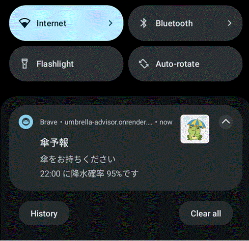
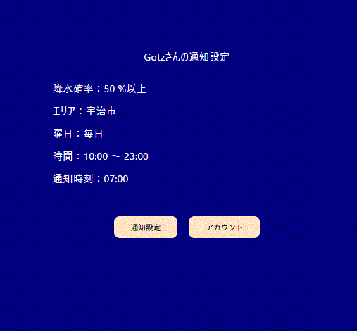
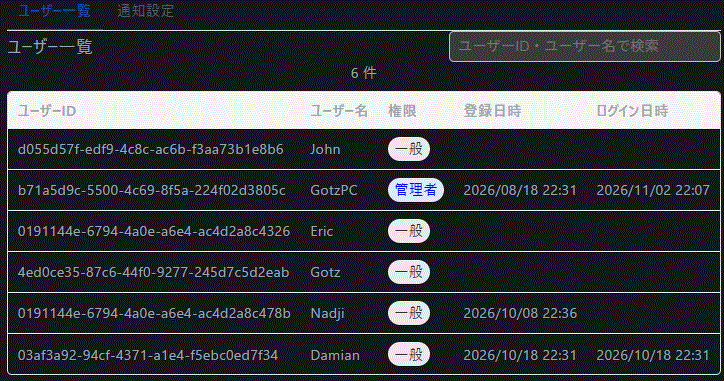

# Umbrella Advisor

「今日傘いる？」を毎朝調べなくて済むように作った、傘の要否を知らせてくれるアプリです。




配布URL：https://umbrella-advisor.onrender.com

## 概要

登録した都市の降水確率を見て、自分で決めたしきい値を超えそうな日に「傘を持っていこう」とWeb Pushで通知します。
天気アプリを毎回開くのが面倒で作り始めました。

React・Express・MongoDBをTypeScriptで通して書き、Renderにデプロイするところまで一通りやってみる、というのが開発の目的です。

設定できる項目は次のとおりです。

- 通知先のメールアドレス
- 都市
- 降水確率のしきい値
- 天気を確認する時間帯
- 通知する時刻

## 使っている技術

- フロントエンド: React (TypeScript)、ビルドは Vite
- 通知: Web Push
- バックエンド: Node.js、Express (TypeScript)
- データベース: MongoDB Atlas (Mongoose)
- 天気データ: Open-Meteo
- 認証: JWT、bcryptjs、express-validator
- ホスティング: Render

クライアントとサーバーを分けず、ルートに package.json を1つ置くモノレポ構成です。

## 苦労したこと

### 通知まわり

**sw.js がブラウザから取得できない**
Service Worker が登録できず調べたところ、`/sw.js` にブラウザからアクセスできませんでした。
原因は vite.config.ts の設定不足で、`client/public` フォルダが無視されていたことです。
設定を直して解決しました。

**WebIDE では通知の動作確認ができない**
通知まわりは WebIDE 上では動かず、確認できませんでした。

**Windows の通知設定がオフだった**
通知が出ない原因は、Windows 側の通知設定がオフだったことでした。
コードを疑う前に、OS とブラウザの通知設定を見るべきでした。

### 実行環境・スケジュール

**WebContainer の cron で Asia/Tokyo を指定できない**
cron のタイムゾーンを指定できず、時刻がずれました。
今は別の Cron Job をやめて、Express の中で30分おきに天気をチェックしています。

**日時のズレ**
Open-Meteo の時刻はタイムゾーン情報のない文字列で、Render のサーバーは UTC です。
Date を使うと、ローカルでは合っていた日付が本番だけずれました。
今は dayjs の `.tz('Asia/Tokyo')` に統一しています。

### コードの書き方

**map の中で await が使えない**
`map` のコールバックでは `await` が使えません。async にしても Promise の配列が返るだけだったので、`Promise.all` で包むか `for...of` で回しています。

**fetch は 4xx / 5xx で例外を投げない**
`catch` に入るのはネットワークエラーだけなので。
`response.ok` を見て、自分で throw するようにしました。

**複数コレクションの更新にはトランザクション**
`Promise.all` で並列に更新すると、途中で失敗してもロールバックされないので、
複数のコレクションをまたぐ更新は Mongoose のセッションでトランザクションにしています。

### DB・外部API
**MongoDB Atlas に接続できない**
`mongodb+srv://` の接続文字列でエラーが出たため、マルチホストURIに切り替えて解決しました。

**429 Too Many Requests で天気が取れない**
天気APIの呼び出しが ステータス429 で失敗しました。
Render無料版の共有アウトバウンドIPが原因でレート制限に該当したと考え、
有料版の専用IPに切替えることが根本解決として期待できますが、
今回は事前にキャッシュを取得することで緩和措置を取りました。

**都市の選択を `_id` キーに変更**
同名の都市があり、英語名をキーにすると一部の都市で正しくデータが取れませんでした。
選択値は `_id` にして、react-select の `filterOption` で英語名でも検索できるようにしています。

## デプロイ

Render の Web Service 1つで、API と React のビルド成果物の両方を配信しています。静的ファイルは `express.static` で返し、SPA 用のフォールバックも入れています。
MongoDB Atlas 側は Network Access の設定が必要でした。

## ローカルで動かす

```bash
git clone https://github.com/Gotz-326/Umbrella-advisor.git
cd Umbrella-advisor
npm install
npm run dev
```

`.env` に必要な値:

```
MONGODB_URI=
SECRET_KEY=
```

## 今後やること

- 管理者用ページの追加（通知の成功・失敗率、APIエラーの確認など）
- 多言語対応、海外タイムゾーン対応
- UV指数や花粉の量の通知
- 通知をクリックした後の降水量グラフ表示